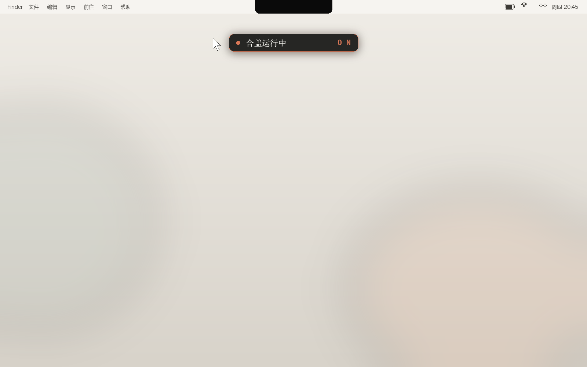

# KeepAwake

**A Dynamic-Island-style lid toggle for macOS.** Hover the notch — a tiny console card appears. Click to choose whether closing the lid sleeps your Mac or keeps it running. Move the mouse away — it's gone. No menu bar icon, no Dock icon, nothing to look at until you need it.



> Swap `pmset disablesleep` on/off with one click · **flip-guard** (auto-restores ON when other tools silently reset it) · passwordless (optional) · universal binary (Apple Silicon + Intel) · macOS 13+

## Why

Sometimes you want the lid closed to sleep your MacBook (battery!). Sometimes you're running something — a download, a local server, a render — and closing the lid should **not** interrupt it.

macOS hides the correct switch (`pmset -a disablesleep`) behind a root-only command, and the usual workarounds (`sleep 0`, Amphetamine-style apps) either keep the machine awake *forever* or don't survive lid-close at all. KeepAwake toggles exactly the switch you need, exactly when you need it.

## Install

### Option A — download the DMG

Grab `KeepAwake.dmg` from [Releases](../../releases), open it, drag **KeepAwake.app** to `Applications`.

The app is ad-hoc signed (not notarized). On macOS 15+ Gatekeeper may block the first launch with *"can't be opened"* — allow it in **System Settings → Privacy & Security → Open Anyway**, or run this once in Terminal:

```bash
xattr -d com.apple.quarantine /Applications/KeepAwake.app
```

It registers itself as a login item on first launch, so it survives reboots.

### Option B — build from source

```bash
git clone https://github.com/Githuiyang/keepawake.git
cd keepawake
./build.sh && open KeepAwake.app
```

Requires Xcode Command Line Tools (`xcode-select --install`).

## Usage

- Move the cursor to the **top-center of the screen** (the notch area) → the card appears
- **Click** to toggle: `OFF` (grey, lid closes → sleep) ↔ `ON` (orange, lid closes → keeps running)
- **Right-click** the card → menu (fix idle sleep, quit)
- Toggling asks for your admin password once each time — unless you install the passwordless rule below

## Passwordless toggle (optional)

By default every toggle pops a system password dialog, because changing power management requires root. If you toggle often, you can allow exactly the three `pmset` commands KeepAwake uses — nothing else:

```bash
sudo sh install-sudoers.sh        # install
sudo sh uninstall-sudoers.sh      # remove anytime
```

This writes `/etc/sudoers.d/keepawake` containing only:

```
YOURNAME ALL=(root) NOPASSWD: /usr/bin/pmset -a disablesleep 0, /usr/bin/pmset -a disablesleep 1, /usr/bin/pmset -a sleep 10
```

Worst case an attacker with your user account can… toggle your lid-sleep setting. No other `sudo` command becomes passwordless.

## How it works

| Action | Command |
|---|---|
| ON | `pmset -a disablesleep 1` |
| OFF | `pmset -a disablesleep 0` + `pmset -a sleep 10` (also repairs a legacy `sleep 0`) |
| Read state | `ioreg -c IOPMrootDomain -l` → `SleepDisabled` |
| Flip-guard | armed while ON; if anything resets the flag, re-applies it within ~5 s (logged as `⟳` in toggle history) |

The floating card is a borderless `NSPanel` parked just below the menu bar. While hidden it is fully click-through (`ignoresMouseEvents`), so it never interferes with anything. A 0.25 s cursor poll decides when to show it.

**Why the flip-guard?** Some remote-control apps ship a "keep the controlled Mac awake" feature that writes `disablesleep` themselves — and reset it to `0` on their own session/idle timers (we caught one such helper doing this on a precise 10-minute cycle). With the guard armed, your ON is simply immune: every external reset is reverted within seconds and recorded in the toggle history (right-click → *copy toggle history*).

Two macOS 26 quirks discovered while building this (and worked around):

1. Emoji set as an `NSStatusBarButton.title` render as **blank space** — that's why this uses SF Symbols / no menu bar item at all.
2. `pmset -g` **no longer displays** `disablesleep`, even when set. The state is read from the IORegistry kernel property instead.

## Compatibility

- **macOS 13 Ventura and later** (tested through macOS 26)
- **Universal binary** — Apple Silicon and Intel
- Non-notched Macs: the card simply appears below the center of the menu bar; everything works the same

⚠️ **Heat note**: running with the lid closed traps heat (the keyboard exhaust is covered). Fine for downloads and light servers; avoid sustained heavy workloads closed-lid, and prefer plugged-in.

## Roadmap

- [ ] Demo GIF + screenshots in `docs/`
- [ ] Optional login-item registration in-app
- [ ] English UI localization
- [ ] Smarter anchor on multi-display setups

## License

[MIT](LICENSE)
